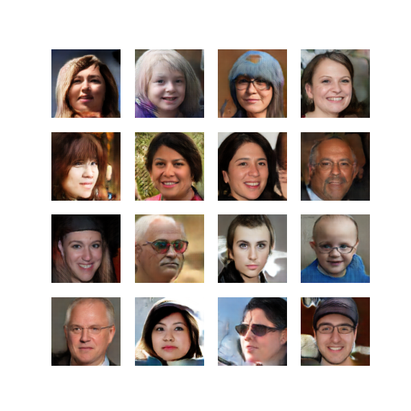

# Génération d'Images de Visages Humains avec WGAN-GP

## Description du Projet

Ce projet implémente un **WGAN-GP (Wasserstein GAN avec Gradient Penalty)** pour générer des images réalistes de visages humains à **128x128 pixels**. Le modèle est entraîné sur le dataset **FFHQ (Flickr-Faces-HQ)** et intègre de nombreuses optimisations de performance et de qualité par rapport à un DCGAN classique.

## 🛠 Technologies Utilisées

- **Python 3.11+**
- **PyTorch** (`torch`, `torchvision`)
- **NumPy**
- **Matplotlib**
- **Pillow**

## Structure du Projet

```
│── data/                      # Contient les images du dataset FFHQ
│── generated_images/          # Stocke les images générées à chaque époque
│── dataset.py                 # Classe CustomDataset pour charger les images
│── model.py                   # Générateur et Critique WGAN-GP
│── train.py                   # Script principal d'entraînement
│── requirements.txt           # Liste des dépendances Python
│── README.md                  # Documentation du projet
```

## Installation

### 1. Cloner le dépôt

```bash
git clone <URL_DU_REPO>
cd <NOM_DU_REPO>
```

### 2. Installer les dépendances

```bash
pip install torch torchvision --index-url https://download.pytorch.org/whl/cu121
pip install -r requirements.txt
```

> ⚠️ PyTorch doit être installé séparément depuis l'index officiel. Remplace `cu121` par `cu118` selon ta version de CUDA (`nvidia-smi` pour vérifier).

### 3. Télécharger le dataset FFHQ

- Télécharger le dataset manuellement depuis [kaggle.com/datasets/arnaud58/flickrfaceshq-dataset-ffhq](https://www.kaggle.com/datasets/arnaud58/flickrfaceshq-dataset-ffhq)
- Extraire le zip et placer les images dans :

```
data/ffhq/
```

La structure doit ressembler à :

```
data/
  ffhq/
    00000.png
    00001.png
    ...
```

> ⚠️ Le dataset FFHQ fait environ 20GB. Prévoir suffisamment d'espace disque.

## Entraînement du Modèle

```bash
python train.py
```

### Hyperparamètres

| Paramètre | Valeur | Description |
|-----------|--------|-------------|
| Époques | 100 | Nombre d'époques d'entraînement |
| Batch size | 64 | Réduit pour le gradient penalty |
| Résolution | 128×128 | Doublée vs DCGAN original (64×64) |
| Vecteur latent (z_dim) | 100 | Dimension du bruit d'entrée |
| Optimiseur G | Adam | `lr=0.0001, betas=(0.0, 0.9)` |
| Optimiseur C | Adam | `lr=0.00005, betas=(0.0, 0.9)` |
| Lambda GP | 15 | Poids du gradient penalty |
| n_critic | 5 | Steps du critique par step du générateur |
| LR Scheduler | CosineAnnealingLR | Décroissance jusqu'à `1e-5` |

Les images générées sont sauvegardées à chaque époque dans `generated_images/`.

## Architecture du Modèle

### Générateur (Generator)

- Prend un vecteur aléatoire (**z_dim=100**) et génère une image **RGB 128×128**
- 6 couches `ConvTranspose2d` : `1×1 → 4×4 → 8×8 → 16×16 → 32×32 → 64×64 → 128×128`
- `BatchNorm2d` + `ReLU` après chaque couche
- `Dropout2d(0.3)` sur les 2 premières couches pour réduire les artefacts
- `Tanh` en sortie pour des pixels entre -1 et 1

### Critique (Critic)

- Remplace le Discriminateur classique — prédit un **score réel** (pas une probabilité)
- 6 couches `Conv2d` avec `spectral_norm` pour stabiliser l'entraînement
- `InstanceNorm2d` à la place de `BatchNorm2d` (compatible gradient penalty)
- `LeakyReLU(0.2)` comme fonction d'activation
- Pas de `Sigmoid` en sortie

## Optimisations Implémentées

### Performance

- **DataLoader optimisé** : `persistent_workers`, `prefetch_factor=2`, `num_workers` adaptatif, `pin_memory`, `non_blocking`
- **Mixed Precision (AMP)** : calculs en FP16 via `autocast` et `GradScaler` — ~2x plus rapide sur GPU récent
- **`cudnn.benchmark=True`** : sélection automatique de l'algorithme de convolution le plus rapide
- **`zero_grad(set_to_none=True)`** : plus rapide que le zero_grad classique

### Qualité

- **WGAN-GP** : Wasserstein loss + gradient penalty pour un entraînement stable sans mode collapse
- **Spectral Normalization** : normalise les poids du critique pour respecter la condition de Lipschitz
- **Résolution 128×128** : doublée par rapport au DCGAN original
- **CosineAnnealingLR** : décroissance progressive du learning rate
- **RandomHorizontalFlip** : augmentation de données pour plus de diversité
- **Dropout2d** dans le générateur pour réduire les artefacts de couleur

## Résultats

| Epoch 1 | Epoch 50 | Epoch 100 |
|---------|---------|-----------|
|  |  |  |

**Évolution** :

- **Epoch 1** : Visages déjà reconnaissables grâce au WGAN-GP
- **Epoch 50** : Visages nets et réalistes, bonne diversité
- **Epoch 100** : Qualité photoréaliste, convergence atteinte

## Comparaison V1 (DCGAN) vs V2 (WGAN-GP)

| | DCGAN V1 | WGAN-GP V2 |
|--|---------|-----------|
| Architecture | Discriminateur + BCE | Critique + Wasserstein |
| Dataset | CelebA (202k images) | FFHQ (70k images haute qualité) |
| Résolution | 64×64 | 128×128 |
| Stabilité | Mode collapse possible | Stable grâce au GP |
| Vitesse | Baseline | ~2x plus rapide (AMP) |
| Qualité | Correcte | Photoréaliste |
