# Génération de visages : du GAN au Diffusion Transformer

Ce projet a commencé comme un **DCGAN** (64×64), puis est devenu un **WGAN-GP** (128×128). Il a ensuite été refondu en **Diffusion Transformer (DiT)** en espace latent, l'architecture des générateurs d'images actuels (Stable Diffusion 3, Sora).

Le DiT (130M de paramètres) est **implémenté et entraîné de zéro** en PyTorch sur FFHQ en 256×256. Il est **contrôlable par 7 attributs** (sourire, lunettes, âge, etc.) et il est comparé au WGAN-GP entraîné dans les mêmes conditions.

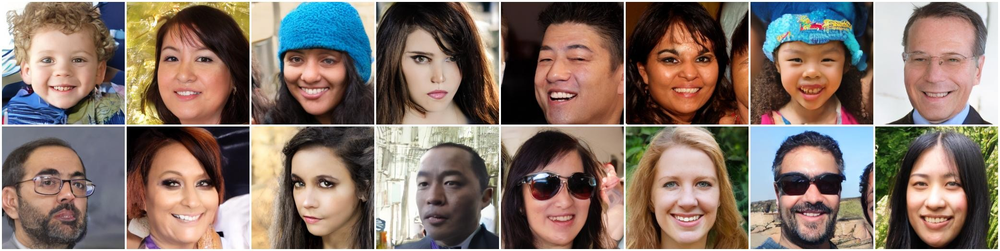
*16 personnes qui n'existent pas, générées par le DiT en 256×256. Tirages non choisis (graine 2026), avec des attributs tirés de la distribution réelle et un guidance de 3.*

---

## Résultats

| Modèle (256×256) | Réglage | FID ↓ | Temps / image |
|---|---|---|---|
| Reconstruction VAE | plafond atteignable par le DiT | 1,32 | 41 ms |
| **DiT** | **guidance 1,5, 50 étapes** | **10,88** | 177 ms |
| DiT | guidance 2, 50 étapes | 11,27 | 174 ms |
| DiT | guidance 1,5, 25 étapes | 12,26 | 101 ms |
| DiT | guidance 1, 50 étapes | 12,31 | 104 ms |
| **DiT sans consigne** | aucun attribut, aucun guidance | **14,15** | 101 ms |
| **WGAN-GP** | baseline | **60,40** | 0,2 ms |

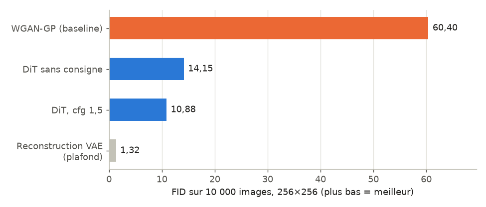

**À retenir :**
- **Sans consigne,** le DiT obtient un FID de **14,15 contre 60,40** pour le WGAN-GP, soit **4,3 fois mieux**. C'est la comparaison stricte : les deux modèles génèrent alors sans aucune aide.
- **Avec son meilleur réglage** (attributs réalistes et guidance 1,5), le DiT descend à **10,88**.
- **La contrepartie :** le WGAN-GP génère environ **500 fois plus vite**, en une seule passe contre 50 étapes de débruitage.

Le FID (Fréchet Inception Distance) compare les statistiques (moyenne et covariance des features Inception-v3) de 10 000 images générées et de 10 000 vraies photos. Plus il est bas, plus les images générées ressemblent aux vraies, en qualité comme en diversité. Tous les modèles sont mesurés contre la même référence.

---

## Comparaison des deux approches

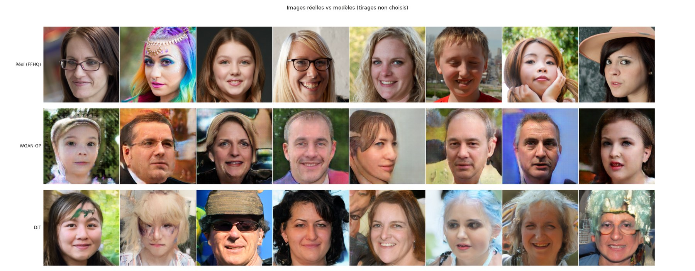
*Ligne 1 : vraies photos FFHQ. Ligne 2 : WGAN-GP. Ligne 3 : DiT **sans consigne**, dans les mêmes conditions que le WGAN-GP. Tirages non choisis : les graines sont fixées dans le code.*

Les visages du WGAN-GP restent reconnaissables, mais ils portent des **artefacts de texture en damier** et des arrière-plans brouillés. Ceux du DiT ont une peau, des cheveux et des arrière-plans plus naturels, avec encore quelques ratés.

| | WGAN-GP | Diffusion Transformer |
|---|---|---|
| **Principe** | Un générateur et un critique qui s'affrontent | Apprendre à retirer du bruit, étape par étape |
| **Objectif d'entraînement** | Distance de Wasserstein + gradient penalty | Flow matching (régression MSE, comme Stable Diffusion 3) |
| **Architecture** | Convolutions (générateur 12,8M + critique 11,2M) | Transformer de 130M paramètres (12 blocs, attention) |
| **Espace de travail** | Pixels 256×256×3 | Latents 32×32×4 d'un VAE pré-entraîné (48× plus petit) |
| **Contrôle** | Aucun | 7 attributs, avec classifier-free guidance |
| **Stabilité** | Réglages délicats (n_critic, lambda_gp, learning rates) | Perte simple qui descend régulièrement |
| **Génération** | 1 passe : **0,2 ms / image** | 25 à 50 étapes : **100 à 177 ms / image** |
| **FID (256×256)** | 60,40 | **14,15** sans consigne, **10,88** au mieux |

**Conditions de la comparaison :**

| | WGAN-GP 256 | DiT 256 |
|---|---|---|
| Dataset | FFHQ, 52 000 images | FFHQ, 52 000 images |
| Résolution | 256×256 | 256×256 |
| GPU | RTX 4070 (12 Go) | RTX 4070 (12 Go) |
| Entraînement en 256 | 50 époques, **9 h 50** (depuis zéro) | 150 000 étapes, **~11 h 30** |
| Pré-entraînement | aucun | 9 h 50 en 128×128 (entraînement progressif) |

Le DiT a donc bénéficié de plus de calcul au total. Pour référence, sa phase 128×128 seule (9 h 50 depuis zéro, autant que le WGAN-GP) atteint un FID de 12,22 en 128×128 (voir [Expériences en 128×128](#expériences-en-128128)). Ce chiffre n'est pas directement comparable aux mesures en 256×256, car la résolution de référence diffère.

---

## Génération contrôlable

Chaque visage de FFHQ a été **annoté automatiquement par CLIP** (ViT-L/14, en zero-shot, sans aucune étiquette humaine) sur 7 attributs : homme, souriant, lunettes, barbe, personne âgée, chapeau, enfant. Le DiT reçoit ces attributs pendant l'entraînement. À la génération, on peut en imposer certains et laisser le modèle choisir les autres.

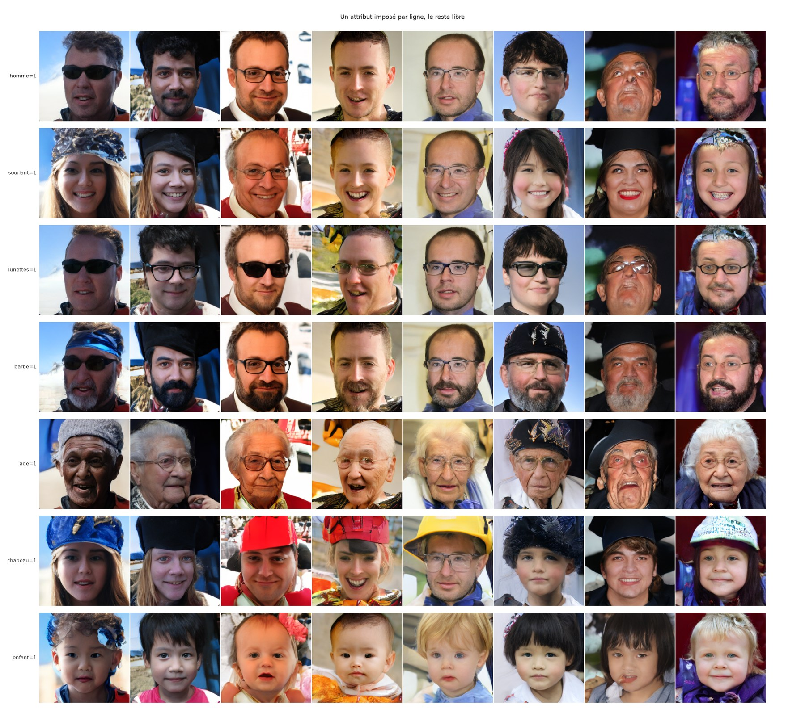
*Un attribut imposé par ligne, le reste libre. Chaque colonne part du même bruit : c'est la même « personne » qui change.*

Les annotations ont été **vérifiées visuellement** avant l'entraînement. La première version (CLIP ViT-B/32) se trompait sur le chapeau et la barbe. Le passage à ViT-L/14 et des descriptions **sans négation** (CLIP comprend mal « sans chapeau ») ont corrigé le problème. La couleur des cheveux, trop peu fiable, a été retirée.

### Effet du guidance

Le **classifier-free guidance** amplifie l'effet des attributs : à chaque étape, le modèle fait une prédiction avec et une sans consigne, et on accentue leur différence. Trop faible, la consigne est mal respectée. Trop fort, les visages deviennent stéréotypés et le FID remonte.

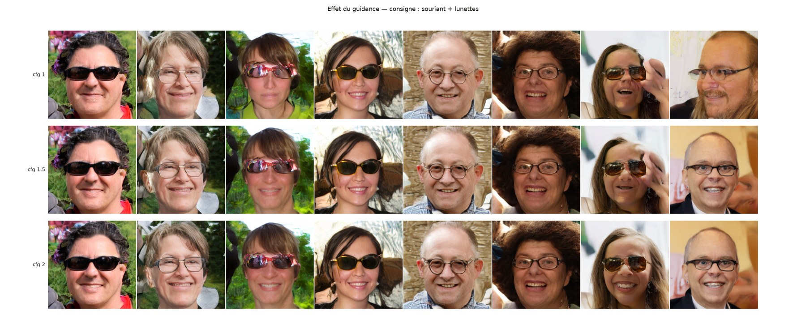

---

## Démo web

Une interface Gradio permet de tester le modèle sans écrire de code.

**Générer des visages à partir d'attributs**, ici : Homme = Non, Souriant = Oui, Lunettes = Oui.

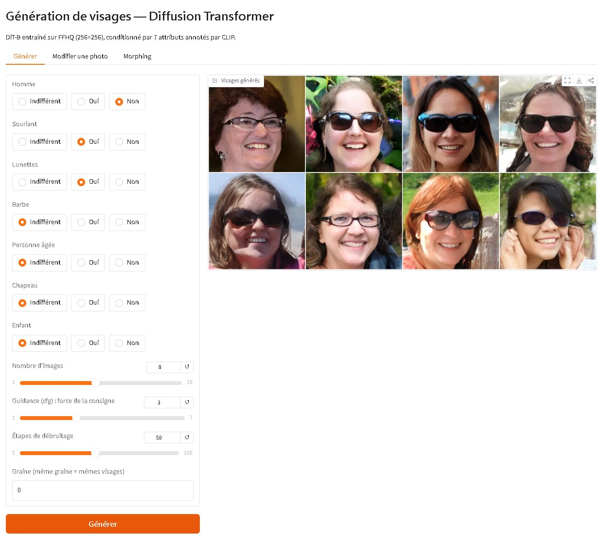

**Retoucher une photo (SDEdit)** : la photo est partiellement bruitée, puis débruitée avec les nouveaux attributs. La photo de départ est elle-même un visage généré par le modèle.

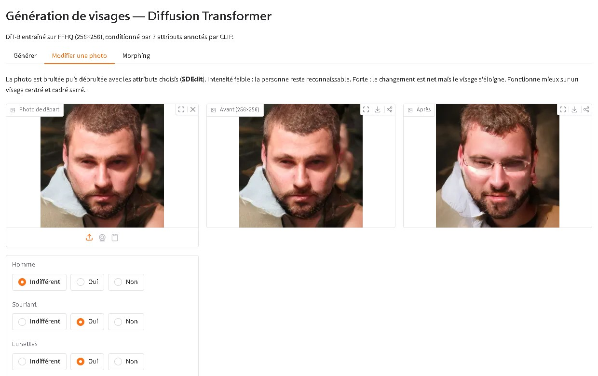

**Morphing** : transition continue entre deux visages, par interpolation sphérique des bruits de départ.

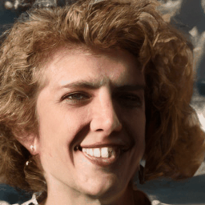

---

## Comment ça marche

```
Image 256×256 ──► VAE (encodeur, figé) ──► latent 32×32×4 ──► patchs 2×2 ──► 256 tokens
                                                                                  │
          bruit + temps t + 7 attributs ──► Diffusion Transformer (12 blocs) ◄────┘
                                                        │
                    vitesse prédite (flow matching) ──► 50 étapes d'Euler ──► VAE (décodeur) ──► visage
```

1. **VAE pré-entraîné** (Stable Diffusion, `sd-vae-ft-ema`, figé) : il compresse chaque image en un latent 48 fois plus petit. Tout FFHQ est encodé **une seule fois** (21 Go de PNG → 855 Mo de latents) : l'entraînement ne lit plus aucune image.
2. **Diffusion Transformer** (Peebles & Xie, 2023), écrit à la main dans [dit.py](dit.py) : le latent est découpé en 256 tokens, et le temps et les attributs conditionnent chaque bloc via **adaLN-Zero**.
3. **Flow matching** (rectified flow, comme SD3) : on mélange l'image et du bruit, `x_t = (1 − t)·x₀ + t·ε`, et le modèle apprend la vitesse `ε − x₀` par régression. Le temps t est tiré selon une loi logit-normale.
4. **Attributs et guidance** : chaque attribut a trois états (oui, non, inconnu). Pendant l'entraînement, 10 % des fiches sont entièrement masquées et 15 % des attributs individuellement, ce qui permet de générer avec ou sans consigne et d'utiliser le classifier-free guidance.

### Entraînement progressif 128 → 256

| Phase | Résolution | Tokens | Batch | Étapes | Learning rate | Durée |
|---|---|---|---|---|---|---|
| 1 | 128×128 | 64 | 192 | 135 000 | 1e-4 constant, puis cosinus à partir de 80k jusqu'à 1e-6 | 9 h 50 |
| 2 | 256×256 | 256 | 48 | 150 000 | warmup 1k, 5e-5, puis cosinus à partir de 75k jusqu'à 1e-6 | ~11 h 30 |

La phase 2 part des **poids de la phase 1**. Un Transformer ne dépend pas du nombre de tokens : seul l'encodage de position (sinus et cosinus) est recalculé pour la nouvelle grille. Les visages en 256×256 étaient reconnaissables après seulement 600 étapes (3 minutes) : le modèle n'a plus qu'à apprendre les détails.

Le passage à 256×256 vise les **détails fins**. En 128, chaque token couvrait 16×16 pixels, et les structures fines comme les montures de lunettes étaient souvent déformées. En 256, la granularité est deux fois plus fine.

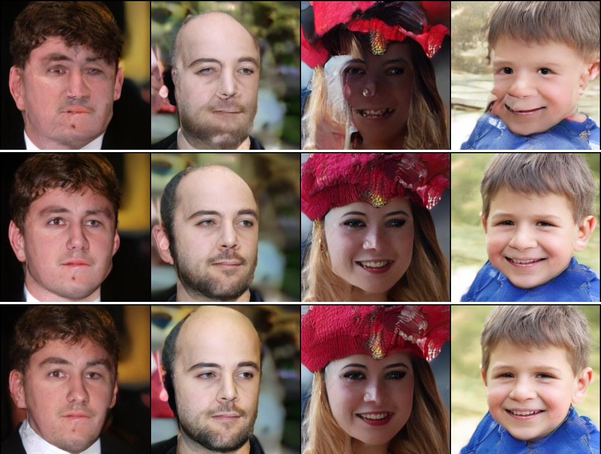
*Mêmes bruits à 10 000, 40 000 et 150 000 étapes de la phase 2.*

---

## Expériences en 128×128

| Réglage (DiT-B/2, 128×128) | FID ↓ |
|---|---|
| Reconstruction VAE (plafond) | 4,62 |
| **Guidance 1,5, 50 étapes** | **12,22** |
| Guidance 1,5, 25 étapes | 12,92 |
| Guidance 3 | 16,39 |
| Guidance 5 | 22,13 |
| **Même modèle à 80 000 étapes**, avant la décroissance du LR | 13,44 |

- **La décroissance du learning rate a été décisive.** Avec un LR constant, la perte et les images stagnaient. Une décroissance en cosinus sur les 55 000 dernières étapes a réduit le FID de **13,44 à 12,22** (−9 %).
- **Le guidance a un optimum net** vers 1,5. Au-delà, la diversité s'effondre et le FID remonte :

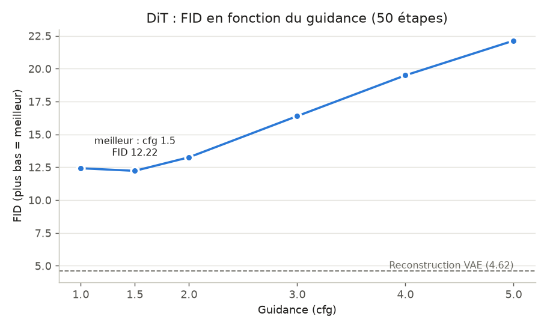

---

## Limites

- **Les occlusions et accessoires** (mains, objets, bijoux) restent les cas les plus difficiles, comme pour la plupart des générateurs d'images.
- **Les combinaisons absentes des données** (« enfant + barbe ») ne sont pas respectées.
- **Les attributs rares** sont moins bien maîtrisés : par exemple, les personnes âgées ne représentent que 1,4 % des annotations.
- **Pas de texte libre** : FFHQ n'a pas de descriptions, seuls les 7 attributs sont disponibles.
- **Le FID repose sur une approximation gaussienne des features Inception** : il ne juge pas chaque image individuellement, et il est mesuré ici sur une seule graine, sans intervalle de confiance.

---

## Installation

```bash
git clone https://github.com/fayssalzakaria/Generation_de_visage_avec_DCGAN.git
cd Generation_de_visage_avec_DCGAN
python -m venv .venv
.venv\Scripts\activate          # Linux / macOS : source .venv/bin/activate
pip install torch==2.6.0 torchvision==0.21.0 --index-url https://download.pytorch.org/whl/cu124
pip install -r requirements.txt
```

**Dataset** : FFHQ ([version Kaggle](https://www.kaggle.com/datasets/arnaud58/flickrfaceshq-dataset-ffhq), 52 000 images en 512×512, environ 21 Go). Il peut être téléchargé avec `python utils.py` ou placé manuellement dans `data/ffhq/`.

## Utilisation

```bash
# 1. Pré-encoder le dataset (latents VAE + attributs CLIP), une seule fois par résolution
python prepare_latents.py --img_size 128 --out data/latents_ffhq128.pt
python prepare_latents.py --img_size 256 --out data/latents_ffhq256.pt

# 2. DiT, phase 1 en 128×128
python train_dit.py --model B --batch_size 192 --steps 135000 --decay_start 80000 --out_dir runs/dit

# 3. DiT, phase 2 en 256×256, à partir des poids de la phase 1
python train_dit.py --latents data/latents_ffhq256.pt --model B --batch_size 48 --steps 150000 \
    --lr 5e-5 --warmup 1000 --decay_start 75000 --init_from runs/dit/last.pt --out_dir runs/dit256

# 4. Baseline WGAN-GP en 256×256 (lancée avec 57 époques prévues, arrêtée après la 50e)
python train.py --img_size 256 --epochs 57 --max_hours 12

# 5. Toutes les mesures : FID, temps, grilles, graphiques
python experiences.py --dit_ckpt runs/dit256/last.pt --out results256 --cfgs 1 1.5 2 --steps_list 25 50

# 6. Générer en ligne de commande
python sample.py --attrs souriant=1 lunettes=1 --cfg 3

# 7. Démo web (http://127.0.0.1:7860), --share pour un lien public temporaire
python app.py
```

## Structure du projet

```
├── dit.py               # Diffusion Transformer (adaLN-Zero) et échantillonneur flow matching
├── vae.py               # VAE pré-entraîné et définition des 7 attributs CLIP
├── prepare_latents.py   # Encodage du dataset : latents VAE + annotations CLIP zero-shot
├── train_dit.py         # Entraînement du DiT (EMA, warmup, cosinus, transfert de poids)
├── pipeline.py          # Génération, retouche SDEdit et morphing
├── sample.py            # Génération en ligne de commande
├── app.py               # Démo web Gradio
├── experiences.py       # FID, temps de génération, grilles et graphiques
├── model.py             # Générateur et critique WGAN-GP (128 ou 256)
├── train.py             # Entraînement du WGAN-GP
├── dataset.py           # Chargement des images
├── results256/          # Mesures FID en 256×256
├── results_b2/          # Mesures FID en 128×128
└── docs/images/         # Figures du README
```

---

## Historique du projet

| Version | Modèle | Résolution | Dataset |
|---|---|---|---|
| V1 | DCGAN | 64×64 | CelebA |
| V2 | WGAN-GP (spectral norm, AMP, cosine LR) | 128×128 | FFHQ |
| **V3** | **Diffusion Transformer latent, conditionné par attributs** | **256×256** | **FFHQ** |

Résultats de la V2 (WGAN-GP 128×128) aux époques 1, 50 et 100 :

| Époque 1 | Époque 50 | Époque 100 |
|---|---|---|
| 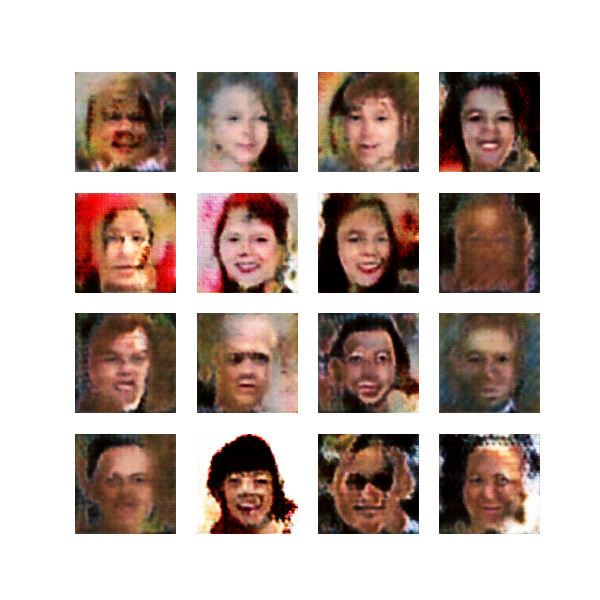 | 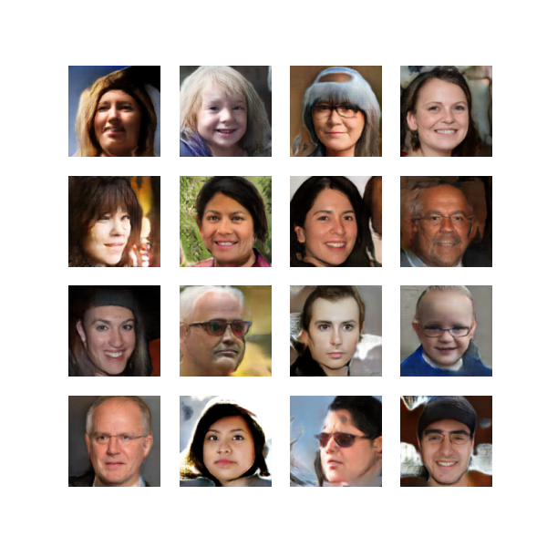 |  |

## Références

- Peebles & Xie, *Scalable Diffusion Models with Transformers* (DiT), 2023
- Esser et al., *Scaling Rectified Flow Transformers for High-Resolution Image Synthesis* (Stable Diffusion 3), 2024
- Ho & Salimans, *Classifier-Free Diffusion Guidance*, 2022
- Meng et al., *SDEdit: Guided Image Synthesis and Editing with Stochastic Differential Equations*, 2022
- Gulrajani et al., *Improved Training of Wasserstein GANs* (WGAN-GP), 2017
- Radford et al., *Learning Transferable Visual Models From Natural Language Supervision* (CLIP), 2021
- Karras et al., *A Style-Based Generator Architecture for GANs* (FFHQ), 2019
